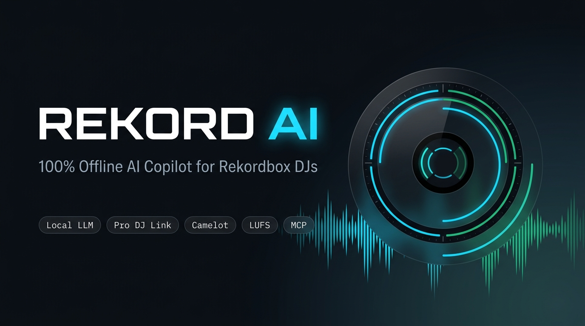
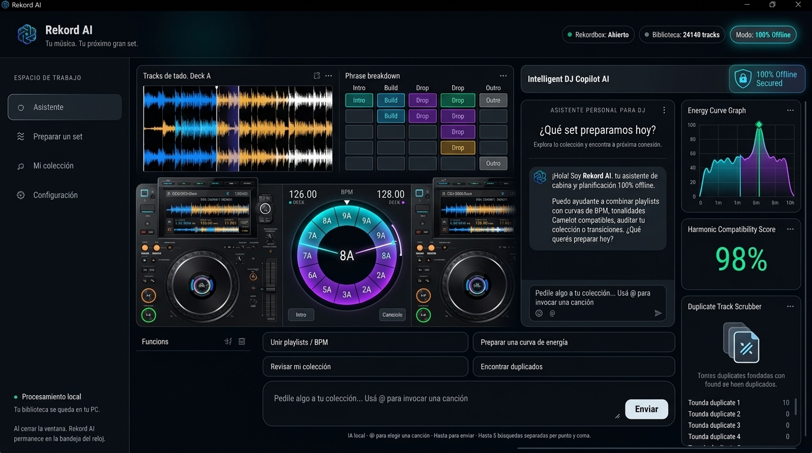
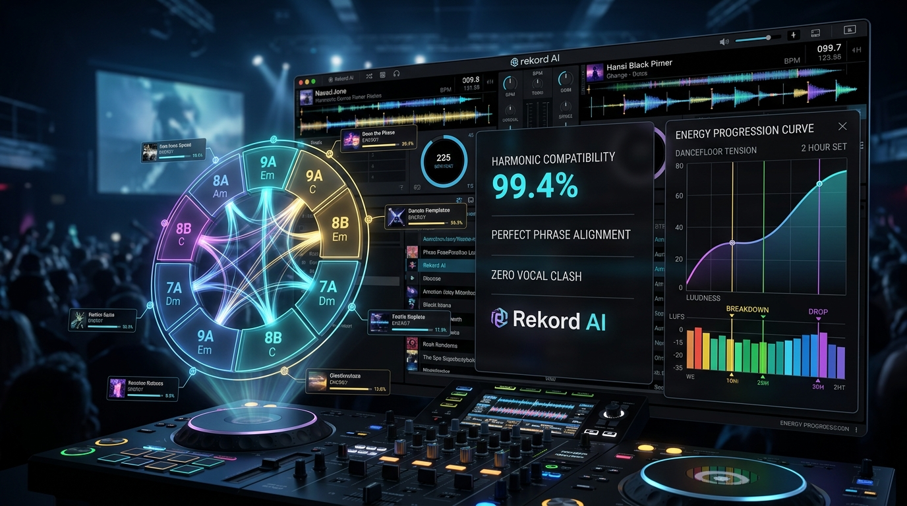
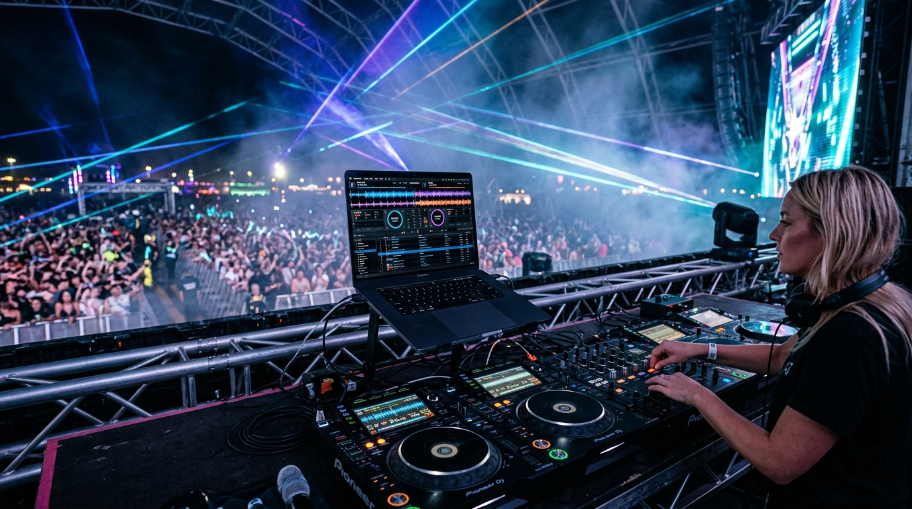
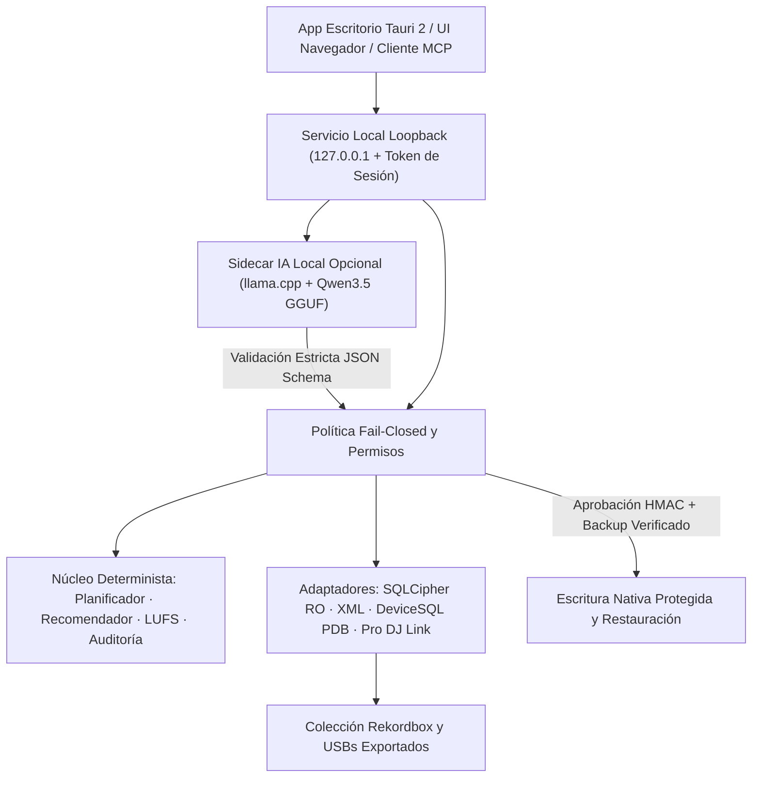

<div align="center">



# Rekord AI · EgoBits

### Tu música. Tu próximo gran set. Copiloto IA 100% Offline para DJs de Rekordbox.

[](release.json)
[](prototype/pyproject.toml)
[](desktop/src-tauri/Cargo.toml)
[](prototype/egobits/mcp_server.py)
[](SECURITY.md)
[](https://cafecito.app/digitalmenteseguro)

**[English](README.md)** | **Español**

*Lectura local de `master.db` y XML · Planificación armónica Camelot · Análisis acústico LUFS · Pro DJ Link y USB DeviceSQL · Limpieza segura de duplicados SHA-256 · IA Local Modular (`llama.cpp` + Qwen3.5) · Servidor MCP Nativo*

</div>

---

## ¿Para qué sirve Rekord AI?

La mayoría de las herramientas con IA envían tu librería privada a la nube, cobran suscripciones mensuales o dejan de funcionar cuando no tenés internet en cabina. **Rekord AI funciona 100% en tu propia computadora**: sin APIs externas, sin telemetría y sin costo.

Ya sea para armar un set de 3 horas con progresión armónica perfecta, auditar más de 25.000 tracks antes de un festival, limpiar archivos de audio duplicados por hash SHA-256 sin perder tus Hot Cues, o conectar clientes MCP (Claude, Cursor, Antigravity, Codex) a tu colección de Rekordbox, **Rekord AI** transforma tu biblioteca en un cockpit inteligente para DJ.

<div align="center">
  
  <br/>
  <sub><i>Cockpit Oscuro Obsidian — Asistente IA Local, Planificador Armónico, Monitor de Cabina en Vivo y Limpiador de Duplicados</i></sub>
</div>

---

## Bondades y Características Principales

<table>
<tr>
<td width="50%" valign="top">

### 1. Conexión Nativa con Rekordbox (`master.db` + XML)
- **Detección Automática**: Detecta automáticamente la base de Rekordbox 6 y 7 en Windows en modo estricto de **sólo lectura (`mode=ro`, `query_only`)** vía SQLCipher.
- **Soporte Bridge XML**: Lectura en streaming hasta 256 MiB y exportación XML/M3U8 no destructiva conservando beatgrids, hot cues, memory cues y rutas Unicode.
- **Cero Sobrescritura**: Siempre genera archivos nuevos; las escrituras nativas permanecen bloqueadas salvo confirmación explícita.

### 2. Planificador Determinista y Rueda Camelot
- **Búsqueda por Beam**: Optimiza secuencias por BPM ascendente o curva de Energía (`0..10`), respetando compatibilidad Camelot, separación de artistas y género.
- **Modo Flexible (`allow_insufficient`)**: Permite construir el set aun cuando hay pocos candidatos compatibles, informando exactamente cada ajuste aplicado.
- **Transiciones por Frases 4/4**: Lee estructuras `ANLZ` (Intro, Build, Drop, Outro) y Hot Cues para proponer mezclas y cambios de tonalidad (`±1` / `±2` semitonos).

### 3. Copiloto IA Local Modular (`llama.cpp`)
- **Sin Nube ni Claves API**: Corre `llama-server` únicamente en `127.0.0.1` con token Bearer efímero por sesión y validación de proceso (`psutil`).
- **Adaptable a Tu PC**: Elegí desde **508 MiB (`0.8B`)** hasta **5.29 GiB (`9B`)** en **CPU**, **Vulkan GPU** o **NVIDIA CUDA**, o usá el **Modo Determinista de 0 MB**.
- **Menciones `@` y Validación Estricta**: Invocá canciones en el chat con `@`; el esquema JSON estricto impide que el modelo ejecute comandos o invente pistas.

</td>
<td width="50%" valign="top">

### 4. Energía Acústica LUFS y Auditoría Pre-Show
- **Medición Offline ITU-R BS.1770**: Calcula sonoridad integrada (LUFS), subgraves y transientes localmente sin tocar tus archivos de audio.
- **Auditoría Completa**: Detecta en milisegundos pistas sin BPM, sin tonalidad, sin género, sin reproducciones, MyTags, estrellas y archivos rotos en colecciones de +20.000 temas.

### 5. Pro DJ Link, USB DeviceSQL y Popup en Cabina
- **Pro DJ Link (UDP 50000–50002)**: Observador pasivo en red (`#7–15`) para reproductores CDJ/XDJ mostrando tempo, posición y estado On-Air.
- **USB DeviceSQL (`.pdb`)**: Audita pendrives exportados desde Rekordbox, detecta referencias huérfanas y prepara playlists seguras con respaldo.
- **Arrastre Directo al Deck**: Ventana flotante siempre visible con arrastre nativo de Windows (`CF_HDROP`) hacia los decks de Rekordbox.

### 6. Limpiador de Duplicados SHA-256 y Servidor MCP
- **Consolidación Segura**: Escanea por tamaño → prefijo → hash SHA-256 completo; consolida playlists, protege cues/`ANLZ` y guarda respaldos recuperables.
- **Recuperación Transaccional**: Toda escritura nativa exige Rekordbox cerrado, backup verificado, vista previa y firma HMAC en Windows.
- **15 Herramientas FastMCP (`stdio`)**: Integrá tu colección con asistentes de IA mediante `python -m egobits.mcp_server`.

</td>
</tr>
</table>

<div align="center">
  
  
</div>

---

## Arquitectura y Seguridad



- **Frontera de Confianza**: La IA local sólo interpreta intenciones o responde consejos basados en hechos reales del XML/DB; **nunca** puede ejecutar comandos del sistema ni modificar `master.db`.
- **Integridad Criptográfica**: Cada binario y modelo GGUF se valida por **SHA-256** antes de iniciarse (`VerifiedAssets` bloquea escritura mientras está cargado).
- **Auditoría de Seguridad**: Consultá [SECURITY.md](SECURITY.md) para ver todas las garantías.

---

## Elección del Motor de IA Local (Archivos Pesados)

GitHub no permite subir archivos mayores a 100 MB (como pesos GGUF de varios GB o compilados binarios). Por eso, **Rekord AI te deja elegir el motor exacto según la capacidad de tu computadora** o usar el sistema **sin descargar ningún modelo (0 MB)**:

| Perfil | Modelo | Tamaño | RAM Mínima | Ideal Para | Descarga Directa |
| --- | --- | --- | --- | --- | --- |
| `none` | **Modo Determinista (Sin LLM)** | **0 MB** | Cualquier PC | Planificador BPM/Camelot, LUFS, Pro DJ Link, MCP y auditoría | *No requiere descarga* |
| `lite` | **Qwen3.5 0.8B** (`Q4_K_M`) | **508 MiB** | 4–6 GB RAM | Laptops livianas de cabina e interpretación rápida | [HuggingFace GGUF](https://huggingface.co/unsloth/Qwen3.5-0.8B-GGUF/resolve/main/Qwen3.5-0.8B-Q4_K_M.gguf) |
| `compact` | **Qwen3.5 2B** (`Q4_K_M`) | **1.19 GiB** | 6–8 GB RAM | Notebooks de gama media: buen equilibrio velocidad/chat | [HuggingFace GGUF](https://huggingface.co/unsloth/Qwen3.5-2B-GGUF/resolve/main/Qwen3.5-2B-Q4_K_M.gguf) |
| `balanced` | **Qwen3.5 4B** (`Q4_K_M`) ⭐ | **2.55 GiB** | 8–16 GB RAM | **Recomendado**: máxima precisión en español y tool calling | [HuggingFace GGUF](https://huggingface.co/unsloth/Qwen3.5-4B-GGUF/resolve/e87f176479d0855a907a41277aca2f8ee7a09523/Qwen3.5-4B-Q4_K_M.gguf) |
| `pro` | **Qwen3.5 9B** (`Q4_K_M`) | **5.29 GiB** | 16+ GB RAM / GPU | Estaciones de estudio y laptops con GPU dedicada | [HuggingFace GGUF](https://huggingface.co/unsloth/Qwen3.5-9B-GGUF/resolve/main/Qwen3.5-9B-Q4_K_M.gguf) |

Motores de inferencia compatibles (`llama.cpp b11146`):
- **`cpu`** (17.7 MiB) — Runtime universal Windows x64 por CPU (sin drivers extra)
- **`vulkan`** (30.6 MiB) — Aceleración por GPU **AMD, Intel Arc y NVIDIA**
- **`cuda`** (615 MiB) — Máximo rendimiento en placas **NVIDIA RTX/GTX** (CUDA 12.4)

> Consultá [docs/AI_ENGINES_AND_MODELS.md](docs/AI_ENGINES_AND_MODELS.md) para ver todos los links directos, hashes SHA-256 e instalación manual sin conexión.

---

## Guía Completa de Instalación (De Punta a Punta)

### Requisitos Previos
- **Sistema Operativo**: Windows 10 (22H2+) o Windows 11 x64 *(recomendado para SQLCipher nativo, WASAPI y shell Tauri; el núcleo Python/CLI/MCP también corre multiplataforma)*.
- **Python**: `3.12+`
- **Opcional (Shell Desktop nativo)**: Rust MSVC + Node.js (`desktop/src-tauri/`).

### Paso 1 — Clonar e Instalar Dependencias

```powershell
git clone https://github.com/facuquilmes123/Rekord_AI_EgoBits.git
cd Rekord_AI_EgoBits

# Crear y activar entorno virtual (recomendado)
python -m venv .venv
.\.venv\Scripts\Activate.ps1

# Instalar núcleo + extras (MCP, verificador IA, SQLCipher nativo, audio LUFS)
python -m pip install -e "./prototype[mcp,ai,native,audio]"
```

> Instalación mínima sin extras nativos/audio: `python -m pip install -e "./prototype[mcp]"`

### Paso 2 — Ejecutar el Script Instalador del Motor de IA

Nuestro script detecta la memoria RAM de tu PC, recomienda el perfil ideal, descarga por HTTPS, verifica los hashes **SHA-256** y configura todo automáticamente:

```powershell
python scripts/setup_ai.py
```

También podés elegir directamente desde consola:

```powershell
# Perfil recomendado (8+ GB RAM, CPU)
python scripts/setup_ai.py --profile balanced --engine cpu

# Notebook liviana (4–6 GB RAM)
python scripts/setup_ai.py --profile lite --engine cpu

# PC de estudio con GPU AMD / Intel / NVIDIA (Vulkan)
python scripts/setup_ai.py --profile pro --engine vulkan

# Modo Determinista sin descargar pesos de IA (0 MB)
python scripts/setup_ai.py --profile none
```

En Windows PowerShell también podés usar: `.\scripts\setup_ai.ps1 -Profile balanced -Engine cpu`.

### Paso 3 — Iniciar Rekord AI

```powershell
cd prototype
python -m egobits --serve
```

Abrí **`http://127.0.0.1:8765`** en tu navegador:
- **Detección Automática**: En Windows conecta automáticamente con tu `master.db` de Rekordbox 6/7 en modo sólo lectura.
- **Modo XML**: También podés cargar cualquier exportación XML en **Configuración → Explorar XML** (o probar la colección de ejemplo `prototype/examples/library.xml`).

---

## Cómo Utilizarlo (UI, CLI y MCP)

### 1. Interfaz de Cabina (`http://127.0.0.1:8765`)
- **Asistente**: Usá `@` para invocar pistas de tu colección. Probá consultas como `"resumí mi colección"`, `"buscá Tech House entre 124 y 128 BPM en 8A"`, `"armá un set de 10 pistas desde toda mi colección"` o `"qué pistas combinan con @Tema"`.
- **Preparar un set**: Elegí playlists de origen, toda la colección o pistas seleccionadas; configurá BPM ascendente o Energía (`0..10`), salto máx. BPM, Rueda Camelot y Modo Flexible; exportá en **XML** o **M3U8**.
- **Mi colección**: Auditá metadatos faltantes y detectá duplicados exactos por SHA-256.
- **Herramientas DJ**: Filtrá por estrellas, MyTags y fecha; analizá frases/cues ANLZ y sonoridad LUFS; auditá USBs DeviceSQL (`.pdb`) y conectá equipos **Pro DJ Link**.

### 2. Línea de Comandos (CLI)

```powershell
cd prototype
python -m egobits --xml examples/library.xml --list
python -m egobits --xml examples/library.xml --playlist ROOT/X --playlist ROOT/Y --count 4 --mode bpm --out mi_set.xml
python -m egobits --xml examples/library.xml --audit
python -m egobits --xml examples/library.xml --duplicates
```

### 3. Integración con Servidor MCP (`stdio`)

Conectá las **15 herramientas MCP** a Claude Desktop, Cursor, Antigravity o Codex:

```json
{
  "mcpServers": {
    "rekord-ai": {
      "command": "python",
      "args": ["-m", "egobits.mcp_server"],
      "cwd": "<RUTA_AL_REPO>/prototype",
      "env": {
        "EGB_LIBRARY_XML": "<RUTA_A_TU_REKORDBOX_EXPORT.xml>"
      }
    }
  }
}
```

---

## Pruebas y Verificación

```powershell
python installer/release_contract.py
python scripts/verify_kit.py
```

---

## Apoyá el Proyecto ☕

Si **Rekord AI** te ahorró tiempo preparando sets, limpiando duplicados o mejorando tus transiciones en cabina:

1. **Dejá una Estrella ⭐ en GitHub** — ayuda muchísimo a que más DJs descubran el proyecto.
2. **Invitame un Cafecito** para seguir impulsando nuevas herramientas gratuitas y open-source para la escena DJ:

<div align="center">

[](https://cafecito.app/digitalmenteseguro)

</div>

---

<div align="center">
<sub>Desarrollado por <b>EgoBits</b> · Proyecto Open-Source Independiente · Rekordbox™ y Pioneer DJ™ son marcas registradas de AlphaTheta Corporation.</sub>
</div>
