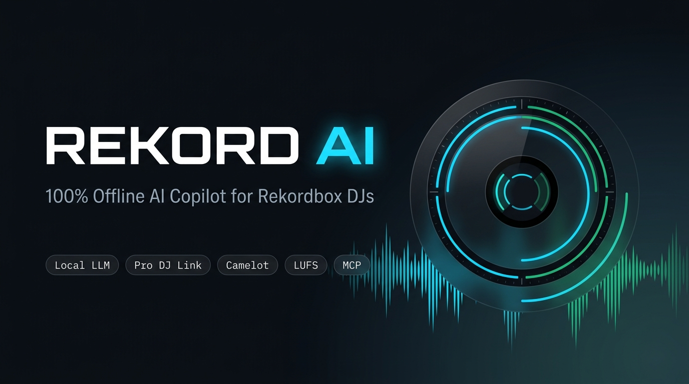
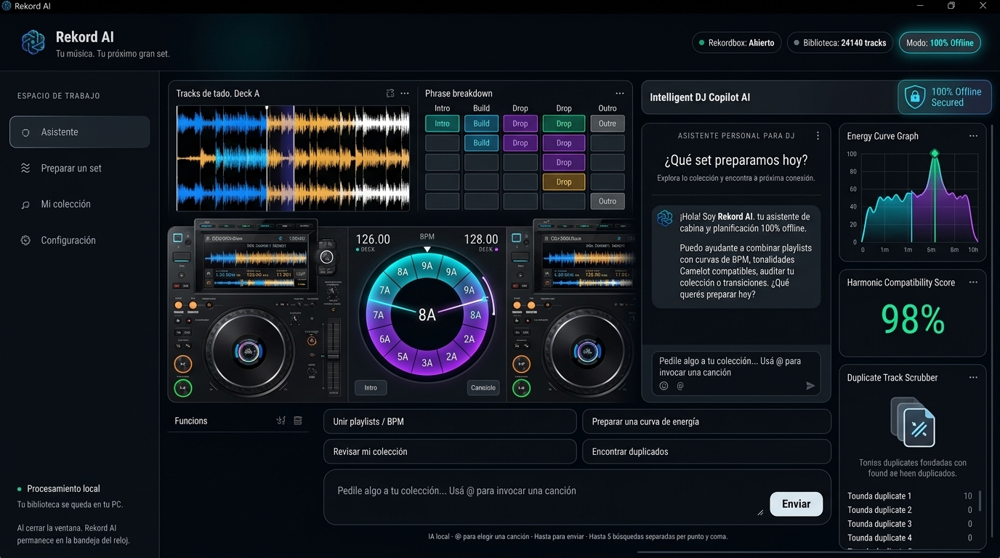
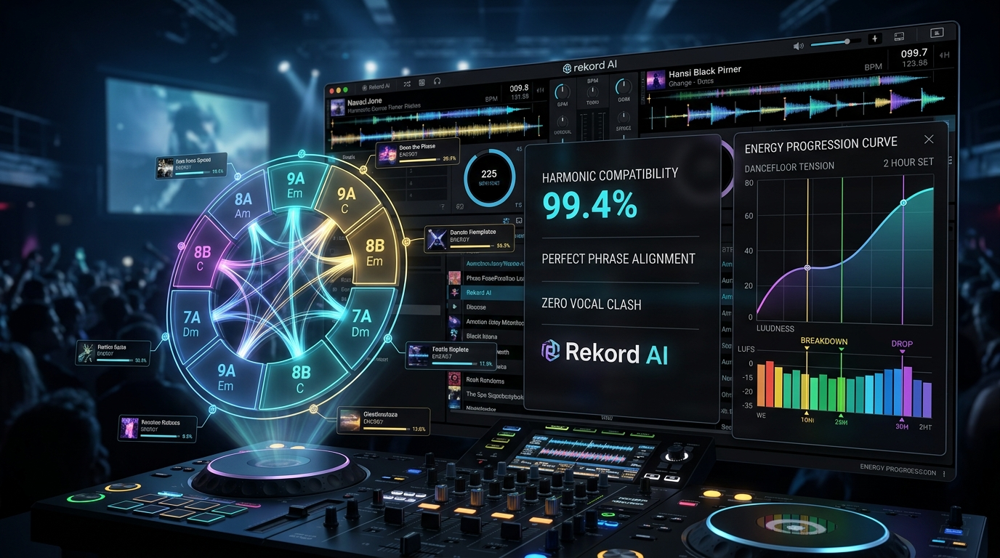
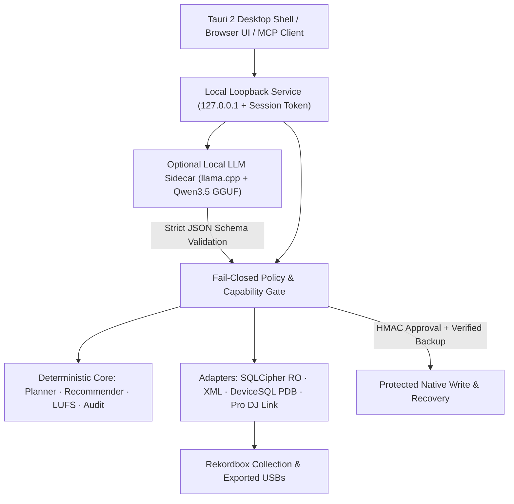
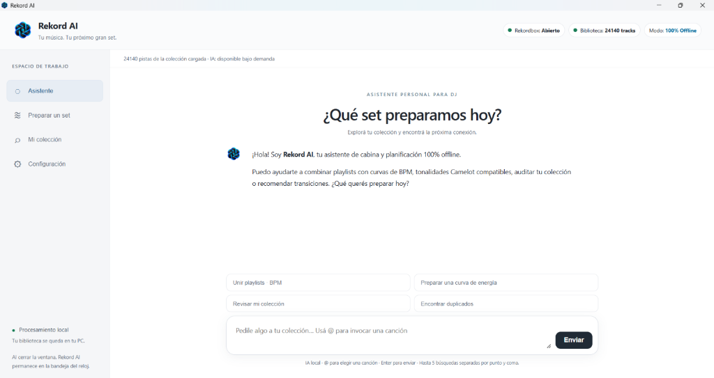

<div align="center">



# Rekord AI · EgoBits

### Your Music. Your Next Great Set. 100% Offline AI Copilot for Rekordbox DJs.

[](https://facuquilmes123.github.io/Rekord_AI_EgoBits/)
[](release.json)
[](prototype/pyproject.toml)
[](desktop/src-tauri/Cargo.toml)
[](prototype/egobits/mcp_server.py)
[](SECURITY.md)
[](https://cafecito.app/digitalmenteseguro)

**English** | **[Español](README.es.md)**

*Read Rekordbox `master.db` & XML locally · Camelot harmonic set planning · ITU-R BS.1770 LUFS energy analysis · Pro DJ Link & USB DeviceSQL · Safe SHA-256 duplicate cleanup · Modular Local LLM (`llama.cpp` + Qwen3.5) · Native MCP Server*

</div>

---

## Why Rekord AI?

Most "AI DJ tools" upload your private library to cloud servers, burn API credits, or break without booth Wi-Fi. **Rekord AI runs 100% on your own machine**—zero cloud APIs, zero telemetry, zero subscriptions.

Whether you are prepping a 3-hour club journey, auditing 25,000+ tracks before a festival, cleaning exact-byte duplicate audio files without losing Hot Cues, or connecting Claude/Cursor/Codex to your Rekordbox collection over **Model Context Protocol (MCP)**, Rekord AI turns your local library into an intelligent DJ cockpit.

<div align="center">
  
  <br/>
  <sub><i>Obsidian Dark DJ Cockpit — Local AI Assistant, Harmonic Set Planner, Live Telemetry HUD & Duplicate Cleaner</i></sub>
</div>

---

## Key Features & Capabilities

<table>
<tr>
<td width="50%" valign="top">

### 1. Live Rekordbox Database & XML Engine
- **Auto-Detection (`master.db`)**: Automatically locates Pioneer/AlphaTheta Rekordbox 6 & 7 databases on Windows in strict **read-only (`mode=ro`, `query_only`)** SQLCipher mode.
- **Bridge XML Support**: Streaming parser up to 256 MiB and non-destructive XML/M3U8 export preserving beatgrids, hot cues, memory cues, and Unicode file paths.
- **Never Overwrites Sources**: Every export writes a brand-new file; native writes stay locked unless explicitly confirmed.

### 2. Deterministic Set Planner & Camelot Engine
- **Beam-Search Set Builder**: Optimizes sequences by ascending BPM or calibrated Energy curves (`0..10`), enforcing Camelot harmonic rules, adjacent-artist spacing, and genre constraints.
- **Flexible Mode (`allow_insufficient`)**: Optionally accommodates tight pools while transparently reporting every relaxed rule.
- **4/4 Phrase Transitions**: Reads `ANLZ` phrase structures (Intro, Build, Drop, Outro) and Hot Cues to explain transitions and suggest Key Shifts (`±1` / `±2` semitones).

### 3. Modular Local AI Copilot (`llama.cpp`)
- **Zero Cloud, Zero API Keys**: Runs `llama-server` strictly on `127.0.0.1` with ephemeral per-session Bearer tokens and `psutil` process-ownership verification.
- **Choose Your Hardware Tier**: Pick from **508 MiB (`0.8B`)** up to **5.29 GiB (`9B`)** across **CPU**, **Vulkan GPU**, or **NVIDIA CUDA**, or run **0 MB Deterministic Mode**.
- **`@track` Mentions & Grounded Answers**: Autocomplete tracks in chat; strict JSON schema validation prevents the LLM from executing shell commands or hallucinating track IDs.

</td>
<td width="50%" valign="top">

### 4. Acoustic Energy & Pre-Show Auditing
- **Offline ITU-R BS.1770 LUFS**: Computes integrated loudness (LUFS), sub-bass density, and transients locally—without modifying audio files.
- **Full-Collection Audits**: Instantly spot missing BPMs, missing keys, missing genres, unplayed tracks, MyTags, star ratings, and broken file paths across 20,000+ tracks in milliseconds.

### 5. Pro DJ Link, USB DeviceSQL & Live HUD
- **Pro DJ Link (UDP 50000–50002)**: Passive network observer (`#7–15`) for CDJ/XDJ setups showing live deck tempo, track position, and On-Air status.
- **USB DeviceSQL (`.pdb`)**: Inspect exported Rekordbox USB sticks, audit orphaned references, and prepare verified playlists with automatic backups.
- **Drag-to-Deck Popup**: Floating always-on-top recommendation window supporting native Windows `CF_HDROP` drag-and-drop into Rekordbox decks.

### 6. Safe Duplicate Cleaner & MCP Server
- **SHA-256 Duplicate Consolidation**: Scans by size → prefix → full SHA-256 hash; consolidates playlist references, protects cues/`ANLZ`, and keeps reversible recovery backups.
- **Transactional Rollback**: Native DB writes require Rekordbox closed, verified backup, preview, and HMAC-signed Windows approval.
- **15 FastMCP Tools (`stdio`)**: Connect your Rekordbox collection to AI coding/agent clients via `python -m egobits.mcp_server`.

</td>
</tr>
</table>

<div align="center">
  
  
</div>

---

## Architecture & Security Model



- **Strict Trust Boundary**: The local LLM proposes structured intents or grounded advice only. It **cannot** invoke shell commands, write `master.db`, or delete audio files.
- **Cryptographic Asset Verification**: All local AI binaries and GGUF weights are verified against pinned **SHA-256** checksums before loading (`VerifiedAssets` holds Windows read-only file locks during inference).
- **No Sensitive Data Committed**: Check [SECURITY.md](SECURITY.md) for the complete security architecture.

---

## Choosing Your Local AI Engine (Heavy Files Guide)

GitHub enforces a 100 MB file limit, so GGUF AI weights (508 MiB – 5.29 GiB) and `llama.cpp` binaries are **not** bundled in the repository. Instead, you can pick the exact engine that matches your computer—or run **100% deterministic mode with 0 MB downloaded**:

| Profile | Model | Download Size | Recommended RAM | Best For | Direct Download |
| --- | --- | --- | --- | --- | --- |
| `none` | **Deterministic Only (No LLM)** | **0 MB** | Any PC | BPM/Camelot planning, LUFS, Pro DJ Link, MCP & audits | *No download needed* |
| `lite` | **Qwen3.5 0.8B** (`Q4_K_M`) | **508 MiB** | 4–6 GB RAM | Lightweight booth laptops & fast intent parsing | [HuggingFace GGUF](https://huggingface.co/unsloth/Qwen3.5-0.8B-GGUF/resolve/main/Qwen3.5-0.8B-Q4_K_M.gguf) |
| `compact` | **Qwen3.5 2B** (`Q4_K_M`) | **1.19 GiB** | 6–8 GB RAM | Everyday DJ laptops balancing speed & chat quality | [HuggingFace GGUF](https://huggingface.co/unsloth/Qwen3.5-2B-GGUF/resolve/main/Qwen3.5-2B-Q4_K_M.gguf) |
| `balanced` | **Qwen3.5 4B** (`Q4_K_M`) ⭐ | **2.55 GiB** | 8–16 GB RAM | **Default**: best accuracy for natural language + tool calling | [HuggingFace GGUF](https://huggingface.co/unsloth/Qwen3.5-4B-GGUF/resolve/e87f176479d0855a907a41277aca2f8ee7a09523/Qwen3.5-4B-Q4_K_M.gguf) |
| `pro` | **Qwen3.5 9B** (`Q4_K_M`) | **5.29 GiB** | 16+ GB RAM / GPU | Studio rigs & maximum conversational reasoning | [HuggingFace GGUF](https://huggingface.co/unsloth/Qwen3.5-9B-GGUF/resolve/main/Qwen3.5-9B-Q4_K_M.gguf) |

Inference backends (`llama.cpp b11146`):
- **`cpu`** (17.7 MiB) — Universal Windows x64 CPU runtime (no GPU drivers required)
- **`vulkan`** (30.6 MiB) — GPU acceleration for **AMD, Intel Arc, and NVIDIA**
- **`cuda`** (615 MiB) — Maximum throughput on **NVIDIA RTX/GTX** GPUs (CUDA 12.4)

> See [docs/AI_ENGINES_AND_MODELS.md](docs/AI_ENGINES_AND_MODELS.md) for all direct download URLs, exact SHA-256 checksums, and air-gapped offline staging instructions.

---

## End-to-End Installation

### Prerequisites
- **OS**: Windows 10 (22H2+) or Windows 11 x64 *(recommended for SQLCipher native auto-detection, WASAPI, and Tauri desktop shell; Python core/CLI/MCP also run cross-platform)*.
- **Python**: `3.12+`
- **Optional (Desktop Native Shell)**: Rust MSVC toolchain + Node.js (`desktop/src-tauri/`).

### Step 1 — Clone & Install Python Core

```powershell
git clone https://github.com/facuquilmes123/Rekord_AI_EgoBits.git
cd Rekord_AI_EgoBits

# Create and activate a virtual environment (recommended)
python -m venv .venv
.\.venv\Scripts\Activate.ps1

# Install core + all optional capabilities (MCP, AI verifier, Rekordbox SQLCipher, LUFS audio)
python -m pip install -e "./prototype[mcp,ai,native,audio]"
```

> Minimal install without audio/native extras: `python -m pip install -e "./prototype[mcp]"`

### Step 2 — Run the Automated AI Engine Setup Script

Run our interactive installer. It detects your PC's RAM, recommends the best model, downloads over HTTPS, verifies SHA-256 hashes, and activates your engine automatically:

```powershell
python scripts/setup_ai.py
```

Or install non-interactively in one command:

```powershell
# Recommended (8+ GB RAM, CPU)
python scripts/setup_ai.py --profile balanced --engine cpu

# Low-RAM laptop (4–6 GB RAM)
python scripts/setup_ai.py --profile lite --engine cpu

# Studio PC with AMD / Intel / NVIDIA GPU (Vulkan)
python scripts/setup_ai.py --profile pro --engine vulkan

# Deterministic mode only (0 MB download)
python scripts/setup_ai.py --profile none
```

### Step 3 — Launch Rekord AI

```powershell
cd prototype
python -m egobits --serve
```

Open **`http://127.0.0.1:8765`** in your browser!
- **Automatic Connection**: On Windows, Rekord AI automatically detects your Rekordbox 6/7 `master.db` in read-only mode.
- **XML Mode**: Prefer XML? Open **Configuración → Explorar XML** (or try the bundled synthetic fixture `prototype/examples/library.xml`).

---

## How to Use (Web UI, CLI & MCP)

### 1. Web / Desktop Cockpit (`http://127.0.0.1:8765`)
- **Asistente (AI Chat + Live Cockpit)**:
  - Use `@` to autocomplete any track from your collection.
  - Ask natural queries: `"summarizá mi colección"`, `"buscá Tech House entre 124 y 128 BPM en 8A"`, `"armá un set de 10 pistas desde toda mi colección"`, `"qué pistas combinan con @Track"`.
- **Preparar un set (Deterministic Planner)**:
  - Pick source playlists, full collection, or hand-picked tracks.
  - Choose `BPM Ascending` or `Energy Curve (0..10)`, max BPM jump, Camelot harmony, and optional **Flexible Mode** (`allow_insufficient`).
  - Export safely as a new **Rekordbox Bridge XML** or **M3U8** playlist.
- **Mi colección (Audit & Duplicate Cleaner)**:
  - Audit missing BPM/Key/Genre metadata and inspect size/SHA-256 duplicate groups.
- **Herramientas DJ (DJ Tools)**:
  - Filter by stars, play count, MyTags, and date added; inspect ANLZ cues/phrases; run offline LUFS loudness analysis; audit Rekordbox USB sticks (`.pdb`); connect live **Pro DJ Link** decks.

### 2. Command-Line Interface (CLI)

```powershell
cd prototype

# List playlists in a Rekordbox XML
python -m egobits --xml examples/library.xml --list

# Plan a 4-track harmonic BPM-ascending set and export to new XML
python -m egobits --xml examples/library.xml --playlist ROOT/X --playlist ROOT/Y --count 4 --mode bpm --out my_set.xml

# Audit missing metadata
python -m egobits --xml examples/library.xml --audit

# Find duplicate tracks
python -m egobits --xml examples/library.xml --duplicates

# Compare two playlists
python -m egobits --xml examples/library.xml --compare ROOT/X ROOT/Y
```

### 3. Model Context Protocol (MCP) Server Integration

Expose **15 typed MCP tools** (`system.status`, `playlist.list`, `library.search`, `playlist.plan`, `playlist.export_xml`, `playlist.compare`, `library.audit`, `library.duplicates`, `transition.explain`, `recommend.manual`, `track.describe`, `library.diff`, `setlist.audit`, `collection.tools`, `collection.execute`) to Claude Desktop, Cursor, Antigravity, or Codex:

```json
{
  "mcpServers": {
    "rekord-ai": {
      "command": "python",
      "args": ["-m", "egobits.mcp_server"],
      "cwd": "<PATH_TO_REPO>/prototype",
      "env": {
        "EGB_LIBRARY_XML": "<PATH_TO_YOUR_REKORDBOX_EXPORT.xml>"
      }
    }
  }
}
```

> Native DB writes and Rekordbox process closing are **never** exposed to MCP or the LLM—they remain strictly gated behind the authenticated Windows desktop workflow.

---

## Interactive Obsidian Landing Showcase

👉 **[Open the Live Interactive Demo on GitHub Pages](https://facuquilmes123.github.io/Rekord_AI_EgoBits/)**

This repository also includes the standalone interactive showcase in [`website/`](website/index.html) featuring a live HTML5 Canvas tri-band CDJ-3000 waveform, interactive Camelot harmonic wheel, and before/after UI comparison slider:

```powershell
python -m http.server 8080 --directory website
# Open http://localhost:8080
```

<div align="center">
  
  &nbsp;&nbsp;
  
</div>

---

## Verification & Tests

Run the release contract check and full unit test suite (327 tests):

```powershell
python installer/release_contract.py
python scripts/verify_kit.py
```

Or run directly with `unittest`:

```powershell
$env:PYTHONPATH = "prototype"
python -m unittest discover -s prototype/tests -q
```

---

## Support the Project ☕

If **Rekord AI** saved you hours preparing sets, cleaning duplicates, or organizing your Rekordbox library:

1. **Give this repository a Star ⭐** — it helps more DJs and open-source builders discover it!
2. **Buy me a Cafecito** to fuel future updates (Linux/macOS packaging, deeper hardware telemetry, and more offline audio tools):

<div align="center">

[](https://cafecito.app/digitalmenteseguro)

</div>

---

## Documentation Index

- [Local AI Engines & Model Downloads](docs/AI_ENGINES_AND_MODELS.md)
- [Architecture Overview](docs/ARQUITECTURA.md)
- [Collection Intelligence v0.4.0](docs/COLECCION_INTELIGENTE_040.md)
- [Production Connectivity & Pro DJ Link v0.4.1](docs/CONEXION_PRODUCTIVA_041.md)
- [Verified Assistant Capabilities](docs/ASISTENTE_CAPACIDADES_0311.md)
- [Safe Duplicate Consolidation](docs/DUPLICADOS_SEGUROS_038.md)
- [Security Policy](SECURITY.md) · [Contributing Guide](CONTRIBUTING.md)

---

<div align="center">
<sub>Built by <b>EgoBits</b> · Independent Open-Source Project · Rekordbox™ and Pioneer DJ™ are trademarks of AlphaTheta Corporation.</sub>
</div>
