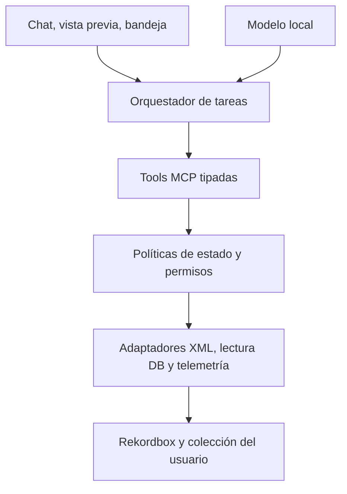

> Documento de diseño previo. Para estado implementado y verificado al 2026-09-23, leer `COBERTURA_PROMPT_ORIGINAL.md`, `REPORTE_VALIDACION_FASE2.md` y `EMPAQUETADO_WINDOWS.md`. Las propuestas aquí no implican funciones disponibles.

# Arquitectura de Rekord AI EgoBits

## Decisión

Cliente Windows Tauri 2 (Rust + interfaz HTML/TypeScript), motor local de interpretación de lenguaje y un único servicio de dominio con herramientas MCP compartidas por el chat y otras integraciones. La planificación debe seguir funcionando sin LLM mediante formularios. El LLM nunca recibe acceso genérico al shell, a archivos arbitrarios ni a SQL libre. Toda escritura se somete a política, vista previa, respaldo y consentimiento explícito para la acción individual.

Separar procesos: Tauri administra bandeja, estado, notificaciones y pantallas; un proceso sidecar local para inferencia en loopback o por tubería; servicio de dominio para catálogo/MCP y planificación. Restringir endpoints a loopback, sesiones con token aleatorio o pipes, sin telemetría de Internet por defecto. MCP `stdio` opcional para Codex y otros clientes aprobados, servidor HTTP local optativo con autorización. No exponer red LAN por defecto.

## Fuentes de datos por orden de madurez

1. **XML exportado por Rekordbox**: lectura con instantánea y hash; modificación solamente mediante *nuevo* XML de playlist para importar por Bridge; ningún conflicto de DB. Lectura durante ejecución permitida si el XML es una copia terminada; no es actualización en tiempo real.
2. **Lectura nativa** con pyrekordbox o adaptador propio en copia/snapshot de la DB cuando su versión sea reconocida. Rekordbox abierto: solo snapshot consistente validado o XML; evitar abrir base activa con escritor. Cache y detectar revisión. Mantener fuentes y metadatos originales de cada campo.
3. **Escritura nativa** como fase posterior optativa, Rekordbox cerrado confirmado, versión certificada, backup integral + hash + ensayo de restauración en copia, precondición de revisión, cambios mínimos, transacción, reconciliación y rollback. Si se desconoce versión, proceso o versión de esquema: bloquear. Un fallo de backup **aborta**.
4. **Reproducción en vivo** por proveedor con señales explícitas: hardware/red solo cuando existe DJ Link y entorno apropiado; plugin/función pública aprobada si aparece; visión/UI Automation y/o audio loopback como prototipo sujeto a hardware y tasa de error. Historial o archivo recién modificado solo sirve para pista reproducida recientemente. Ninguna de esas fuentes autoriza afirmar «sonando» sin validación. No inyectar DLL ni asumir que la pista resaltada está en el master.

Evento `NowPlaying`: `track_id`, `deck_id`, `observed_at_utc`, `source`, `confidence`, `playback_state`, `audible_confidence`; caduca si la señal no se renueva en el umbral configurado. Mostrar proveedor/calidad en UI. Si no hay deck audible confiable, generar candidatos a pedido con pista seleccionada manualmente, sin notificación automática.

## Recomendación, planificación y energía

La red neuronal entiende «armá una lista que suba de 124 a 128 BPM mezclando X e Y». Produce un objeto de intención validado con playlist origen, cantidad, curva, saltos, key y restricciones. El optimizador determinista usa filtros duros y puntuaciones transparentes. BPM tiene relaciones ×2/÷2 opcionales, pero deben explicarse; no mezclar por defecto pistas de tempo muy distinto. Tonalidad Camelot es una ayuda heurística; la armonía real depende de arreglo y mezcla. Género admite etiquetas múltiples, normalización personalizada y ponderación configurable. Considerar artistas repetidos, duración, música recién sonada, rating, cortes de intensidad y tags sin inventar sus valores.

Energía debe tener valor numérico, escala y procedencia. Priorizar valoración manual del DJ; futuro análisis de audio local con características como RMS/LUFS, dinámica, densidad de onsets y secciones, calibradas por género y verificadas con evaluación humana. Ese valor es **estimación**, no propiedad universal ni necesariamente disponible en la DB. Si la solicitud exige ascenso estricto y no hay energía válida, preguntar por modo proxy visible o solicitar anotación; nunca cambiar de objetivo sin avisar.

Conjunto de salida: track IDs, campos originales, filtros/exclusiones, variación BPM/key/energía por transición, razones, revisión de fuente, duración estimada y XML nuevo. Comparar nuevo XML con original, validar contra especificación oficial y probar importación real en matriz Windows. El prototipo `prototype/` implementa un subconjunto: XML, plan BPM/energía, compatibilidad Camelot simplificada, filtrado y exportación; búsqueda por beam acotada (puede no encontrar una solución existente), no detecta audio ni importa automáticamente en Rekordbox.

## Modelo de permisos y observabilidad

Cada tool declara `required_state` (`open`, `closed`, `any`), `capability`, `read_only`, `confirmation`, `data_source`, `freshness`, `performance_cost`. La UI consulta a un motor de estado, bloquea botones no elegibles y explica por qué. La misma política se aplica en backend aun cuando un MCP externo invoque una tool directamente. Estado desconocido de proceso implica bloqueo de escritura; cerrar Rekordbox **no** se hace automáticamente durante un set.

Para notificaciones: opt-in, intervalos mínimos, modo no molestar, silenciamiento desde tray, sugerir antes del final configurable, no en show si CPU supera umbral; deduplicar y mostrar explicación breve («+1 BPM, 8A→9A, mismo género»), evitando datos de pistas no verificadas. Historial local de sugerencias se puede borrar. Persistir datos en perfil de usuario, cifrar secretos que pudieran existir; no registrar rutas de música, chat o datos privados en logs por defecto.

## Capas de prueba imprescindibles

Contract tests del catálogo MCP, XML fixture con caracteres internacionales y cues/beatgrids, no sobrescritura, relectura XML; ensayos en Windows 10 (22H2 y escenarios anteriores si se prometen) y Windows 11 x64; versiones Rekordbox 6/7 soportadas; rechazo de escritura con proceso abierto/desconocido y con backup fallido; hashes y rollback; set con dos playlists, tempo ascendente; pruebas por hardware de señal master/audible con 2 decks, crossfader y canal silenciado; consumo de CPU/RAM durante sesión DJ; instalación y arranque **sin internet real**.

Fuente de interfaz: [Tauri Windows installer](https://v2.tauri.app/distribute/windows-installer/), [system tray](https://v2.tauri.app/learn/system-tray/); diseño del protocolo: [MCP tools](https://modelcontextprotocol.io/specification/2025-06-18/server/tools/).
